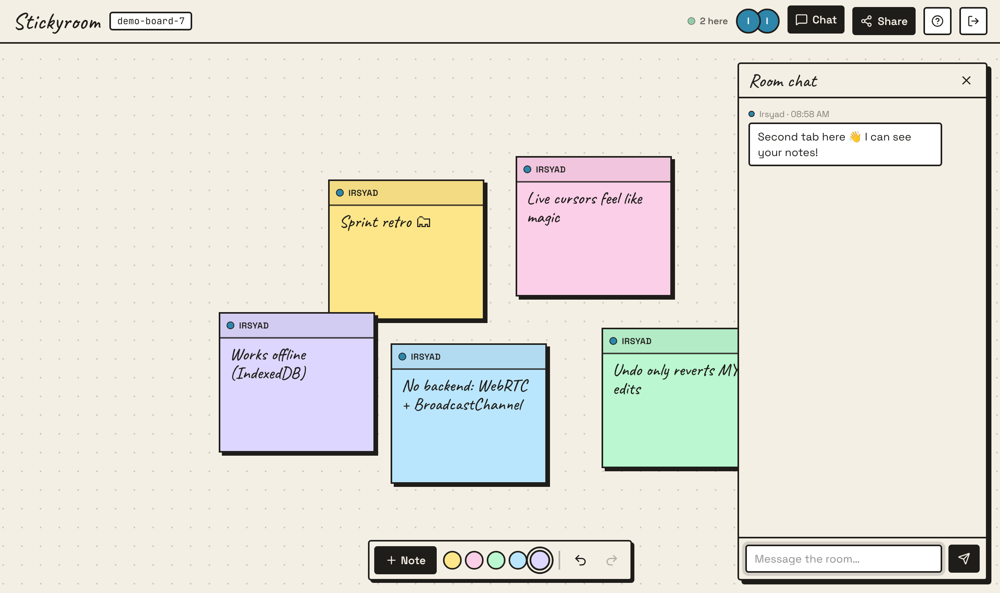
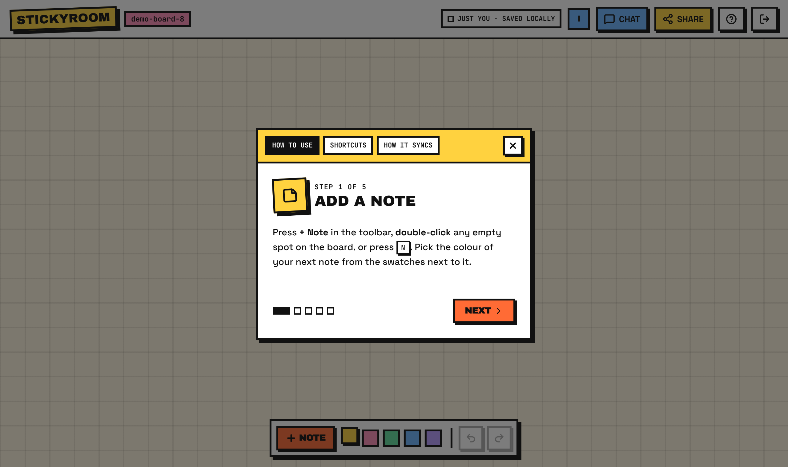

# Stickyroom

A real-time, multiplayer sticky-note board with live cursors and chat, and **no backend**. There's no server, no database and no API keys: the board syncs browser-to-browser and is saved on your device.

**Live demo:** https://irsyadfptr.github.io/stickyroom/. Open it in **two tabs** to see it work.



## How to use

1. **Join.** Enter a name and pick a cursor colour. That's it, no account. Your name is remembered on this device.
2. **Add a note.** Press **+ Note** in the bottom toolbar, **double-click** an empty spot, or press **N**. The swatches next to the button set the colour of your next note.
3. **Move and write.** Drag a note by its **top strip**, and click the body to type. Hover a note and click the trash icon to delete it. The board is larger than the screen, so scroll around.
4. **Invite someone.** **Share** copies the room link (`?room=amber-otter-42`). Everyone with the link edits the same board and sees each other's cursors. To try it alone, open the link in a second tab.
5. **Chat.** **Chat** in the top bar (or **C**) opens a side panel for the room. On phones it's a bottom sheet.
6. **Undo is personal.** **Ctrl/⌘ Z** undoes only *your* changes; a teammate's edits are never reverted. **Ctrl/⌘ Shift Z** or **Ctrl Y** redoes.
7. **Need help later?** The **?** button reopens the in-app guide, the shortcut list and a short "how it syncs" explainer.

| Shortcut | Action |
| --- | --- |
| `N` | New note in the middle of the view |
| Double-click | New note at the pointer |
| `Ctrl/⌘ Z` | Undo your last change |
| `Ctrl/⌘ Shift Z`, `Ctrl Y` | Redo |
| `C` | Toggle chat |
| `?` | Open the guide |
| `Esc` | Close panels |



## How it works without a backend

The board is a [Yjs](https://yjs.dev) CRDT document. Every browser holds a full copy, and copies merge automatically, with no conflicts and no server deciding who wins.

```
  tab A ◄── BroadcastChannel ──► tab B          same browser: no network at all
    │
    └──── WebRTC (peer-to-peer) ───► another device
              ▲
              └ a public signaling server only introduces peers; board data never goes through it
    │
  IndexedDB  (a copy on this device: survives reloads, works offline, merges on reconnect)
```

| Data | Yjs type | Why |
| --- | --- | --- |
| Notes | `Y.Map` of id → note | Concurrent add, move and delete of different notes never conflict |
| Chat | `Y.Array` | Appends from several people merge in a stable order (last 200 kept) |
| Cursors, who's here | Awareness | Short-lived state that isn't saved |
| Undo | `Y.UndoManager` with `trackedOrigins: [doc.clientID]` | Undo only reverts transactions this client made |

**Limits, honestly:**
- Cross-device sync relies on WebRTC and y-webrtc's free public signaling server. Strict corporate networks can block it, while same-browser tabs always work.
- A room only lives on the devices that have opened it. There's no central copy, so if everybody clears their browser data the board is gone.
- Two people typing in the *same* note at the same moment: the last write wins for that note's text.

To use your own signaling server, set `NEXT_PUBLIC_SIGNALING_URLS=wss://your-server` (comma-separated) at build time. It's optional.

## Tech

Next.js 16 (static export) · React 19 · Tailwind CSS 4 · Yjs · y-webrtc · y-indexeddb · lucide-react

```
src/
  app/page.js              the board: toolbar, shortcuts, pointer/cursor tracking
  components/YjsProvider   Y.Doc + WebRTC + IndexedDB per room, join screen
  components/Note          one draggable note
  components/CollabChat    room chat panel
  components/Guide         first-visit walkthrough, shortcuts, sync explainer
  components/TopBar        room name, presence, share
  hooks/useBoard           notes + per-user undo, chat (Yjs ⇄ React)
  hooks/usePresence        peers from Yjs awareness
  lib/room                 room ids in the URL
```

## Run locally

```bash
npm install
npm run dev        # http://localhost:3000
npm run build      # static site in out/
npm run lint
```

## Deploy

It's a static site, so there are no env vars to set.

- **Vercel:** import the repo and deploy. The defaults work.
- **GitHub Pages:** `.github/workflows/pages.yml` builds `out/` on every push to `feat/serverless-board`. One-time setup: **Settings → Pages → Source: GitHub Actions**. The site is served at `https://irsyadfptr.github.io/stickyroom/`.

The old WebSocket server (`yjs-be`) is no longer needed.
